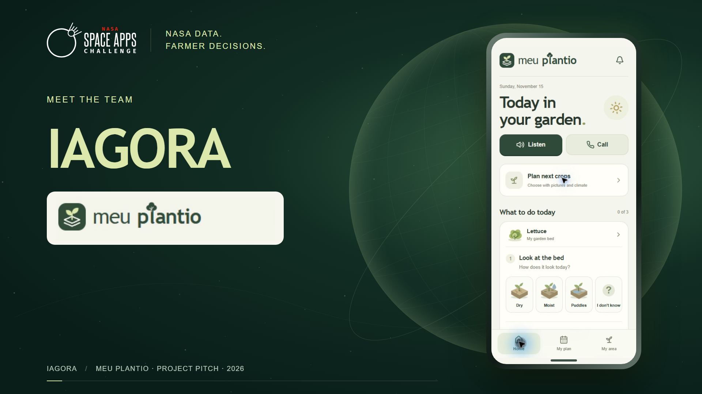

# Meu plantio 🌱

**Dados da Terra mais próximos de quem cultiva nossos alimentos.**

Projeto da equipe **IAGORA** para o **NASA Space Apps Challenge 2026**. O Meu plantio propõe apoiar pequenos produtores de hortaliças no planejamento de rotações, conectando informações ambientais, histórico do canteiro e escolhas do agricultor por meio de ilustrações e áudio.

Este repositório reúne a **landing page e o aplicativo**, em uma única aplicação Next.js. A interface e o pitch estão em inglês.



## Conheça o projeto

**Online:** [Apresentação](https://meu-plantio-one.vercel.app/) · [Aplicativo](https://meu-plantio-one.vercel.app/app) · [Pitch](https://meu-plantio-one.vercel.app/#pitch)

| Caminho | Conteúdo |
| --- | --- |
| `/` | Landing page: problema, persona, proposta, dados, voz e impacto |
| `/#pitch` | Pitch de 30 segundos, com narração em inglês |
| `/#team` | Equipe IAGORA e links para o LinkedIn |
| `/app` | Início do aplicativo |
| `/plan` | Planejar rotação |
| `/my-plan` | Meu plano |
| `/notices` | Alertas e conversas |
| `/my-area` | Minha área e histórico |
| `/design-system` | Catálogo de desenvolvimento com componentes reais |

O botão **Explore the demo** abre `/app` no mesmo domínio. Os links Home do app e o início da instalação PWA também apontam para `/app`. As outras telas mantêm os caminhos indicados acima.

O repositório público aparece no menu do topo (também no celular), no botão **View on GitHub** ao lado de **Explore the demo** e no rodapé. Os links abrem em uma nova aba.

## Por que existe

Planejar o próximo cultivo envolve clima, água, histórico da área, tempo e orçamento. Essas informações costumam chegar separadas. Mudanças nos padrões de chuva e temperatura, incluindo efeitos regionais do El Niño, aumentam a necessidade de revisar decisões.

A proposta considera barreiras de leitura e acesso à informação. Imagens, linguagem simples e áudio ajudam a tornar a decisão compreensível. O produtor mantém o controle: pode confirmar, corrigir, recusar ou adiar.

## Implementação e limites

| Recurso | Estado |
| --- | --- |
| Landing page | Responsiva, com pitch, fontes, equipe e acesso ao app |
| Planejamento e acompanhamento | Telas conectadas pelo `FarmProvider`, separando cultivo atual e próximo cultivo |
| Registros e escolhas | Persistência local no navegador, sem sincronização de servidor |
| Histórico climático | NASA POWER regional de 2021–2025; não é sensor do canteiro nem previsão sazonal |
| Previsão de sete dias | Open-Meteo, com fonte, horário e validade; depende do serviço externo |
| Voz | Síntese do navegador, acionada pelo usuário; vozes e disponibilidade dependem do dispositivo |
| Predição da rotação completa | Visão central em desenvolvimento; comparação agronômica e resultados locais exigem validação |
| Ligação contextual | Fluxo proposto: alerta → solicitação → conversa → confirmação → resumo em áudio. Telefonia ainda indisponível |
| Instalação PWA | Manifesto e ícones preparados; interface completa offline ainda não implementada |

Redução de desperdício, economia de água, produtividade e recuperação do solo são **objetivos a medir**, não resultados comprovados. Capturas e demonstração podem conter registros e planos de exemplo, identificados na interface.

## Rodar localmente

Requisitos: **Node.js 22** recomendado (mínimo 20.9) e npm.

```bash
git clone https://github.com/grimmhud/meu-plantio.git
cd meu-plantio
npm ci
npm run dev
```

Apresentação: **http://localhost:3018/**. Aplicativo: **http://localhost:3018/app**.

Não é necessária chave de API para as fontes públicas atuais. Para abrir com os exemplos da demonstração preenchidos, crie `.env.local` e reinicie o servidor:

```dotenv
DEMO_MODE=true
```

O modo de demonstração usa armazenamento separado (`agroloop:demo:*`), preservando registros normais (`agroloop:*`). Previews da Vercel também ativam esse modo. Sem a configuração, desenvolvimento e produção usam o modo normal.

```bash
npm test
npm run typecheck
npm run build
npm start
```

O servidor de produção local também usa a porta 3018. Execute apenas um servidor por vez nessa porta.

## Estrutura

```text
src/app/(presentation)/  Landing e layout próprios
src/app/(producer)/      Telas, layout e FarmProvider do app
src/app/api/             Endpoints de clima e conversa
src/app/manifest.ts      Instalação PWA, com início em /app
src/presentation/        Conteúdo, estilos e componentes da landing
src/frontend/            Interface e estado do produtor
src/backend/             Integrações e lógica de servidor
src/shared/              Contratos e regras compartilhadas
public/media/            Pitch, capturas e ilustrações
public/team/             Fotos dos integrantes
public/brands/           Marca e identidade do evento
data/nasa/               Séries e registros de procedência
docs/                    Produto, evidências e decisões
tests/                   Verificações das regras implementadas
```

Grupos entre parênteses não aparecem na URL. Layouts raiz separados preservam os estilos e o estado de cada experiência. A navegação entre landing e app recarrega a página; escolhas do produtor permanecem no armazenamento local.

## Publicar na Vercel

Importe **grimmhud/meu-plantio**, selecione **Next.js**, diretório raiz do repositório e Node.js 22. Build: `npm run build`. Mantenha a saída padrão do Next.js.

Este projeto inclui endpoints de servidor: **não use exportação estática**. Landing e app são publicados juntos, sem depender da URL antiga. Configure `DEMO_MODE=true` em Production para abrir preenchido na apresentação do evento.

A publicação atual foi feita pela CLI autenticada no projeto `meu-plantio`, da equipe `hudson-oliveiras-projects`. A conexão automática com GitHub ainda não está habilitada: novos pushes não publicam sozinhos. Para atualizar manualmente com acesso à equipe:

```bash
npx vercel link --project meu-plantio --scope hudson-oliveiras-projects
npx vercel deploy --prod --scope hudson-oliveiras-projects
```

## Evidências e fontes

- [IBGE — Censo Agropecuário 2017](https://agenciadenoticias.ibge.gov.br/agencia-noticias/2012-agencia-de-noticias/noticias/25786-em-11-anos-agricultura-familiar-perde-9-5-dos-estabelecimentos-e-2-2-milhoes-de-postos-de-trabalho): aproximadamente 3,9 milhões de estabelecimentos familiares, 77% dos estabelecimentos brasileiros em 2017. Contexto nacional histórico, não contagem local de horticultores.
- [Ipea — capítulo 6, tabela 7, p. 269](https://repositorio.ipea.gov.br/bitstream/11058/14052/6/Agricultura%20familiar_Cap6.pdf#page=34): 26,4% dos produtores familiares não sabiam ler e escrever, com base em 2017. Não é estimativa atual nem percentual específico de Mogi das Cruzes.
- [NASA POWER](https://power.larc.nasa.gov/): histórico regional de temperatura, chuva e radiação. Procedência em `data/nasa/`.
- [Open-Meteo](https://open-meteo.com/): previsão meteorológica de sete dias, distinta do histórico NASA.
- [INPE — El Niño em 2026](https://www.gov.br/inpe/pt-br/assuntos/ultimas-noticias/nota-tecnica-conjunta-aponta-alta-probabilidade-de-el-nino-no-segundo-semestre-de-2026): efeitos dependem da região e do evento.
- [NASA Space Apps — materiais de marca](https://www.spaceappschallenge.org/brand/): identidade oficial do evento. Participação e uso de dados não representam endosso da NASA ao produto.

## Equipe IAGORA

| Integrante | LinkedIn |
| --- | --- |
| Hudson Oliveira | [grimmhud](https://www.linkedin.com/in/grimmhud/?locale=en) |
| Joana Carolina | [joanacarol](https://www.linkedin.com/in/joanacarol/) |
| Ane Freitas | [anefreitas](https://www.linkedin.com/in/anefreitas/) |
| Jessica Pereira | [jessiepsx](https://www.linkedin.com/in/jessiepsx/) |
| Luís Garcês | [luisgarces2005](https://www.linkedin.com/in/luisgarces2005/) |
| Ingrid Lorena | [ingrid-lorena](https://www.linkedin.com/in/ingrid-lorena/) |

## Documentação e licença

- [Produto](docs/product-definition.md): referência local congelada; inclui capacidades futuras.
- [Conteúdo e decisões atuais](docs/content.md).
- [Design system](docs/design-system.md).
- [Continuidade e estado compartilhado](docs/continuidade.md).
- [Áudio e limites](docs/audio.md).
- [Notas de origem da landing](docs/presentation.md): registro anterior à integração neste repositório.

Código sob [Apache License 2.0](LICENSE), preservando a licença existente. Fotos e marcas de terceiros mantêm os direitos dos respectivos titulares; a licença de código não concede direitos sobre esses materiais.
