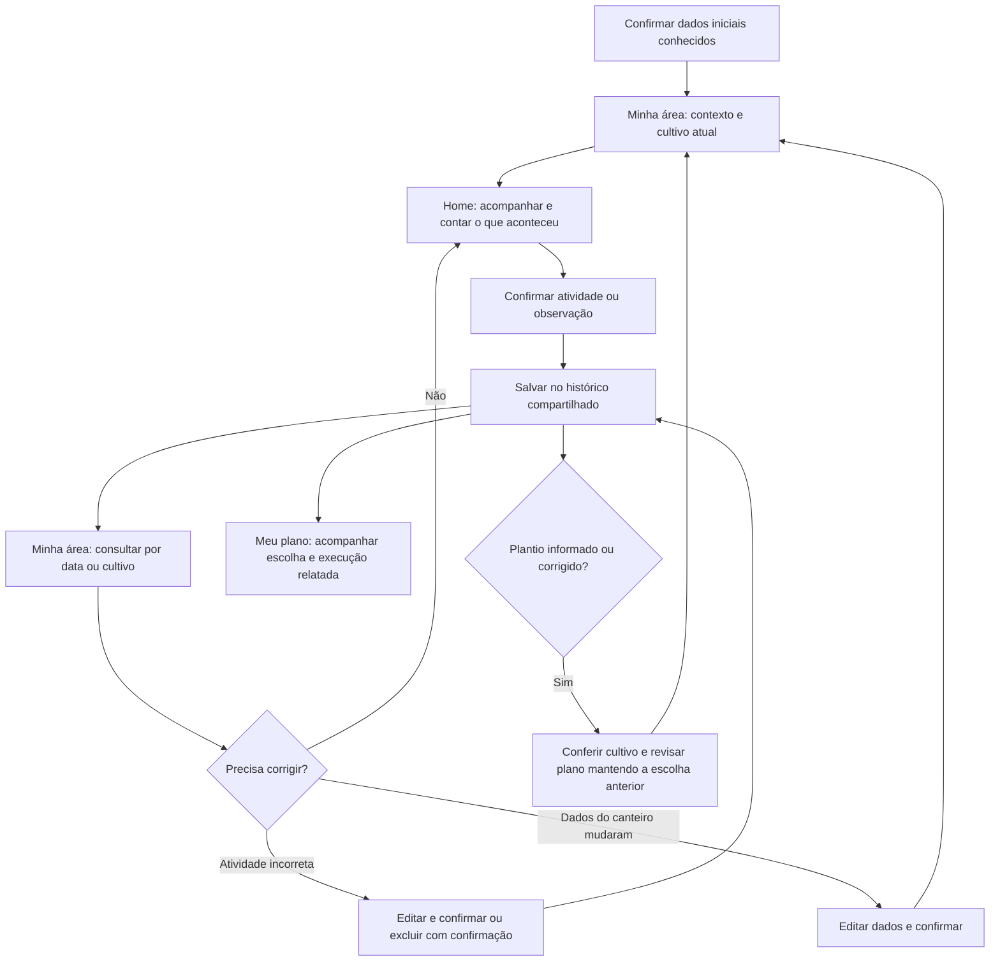
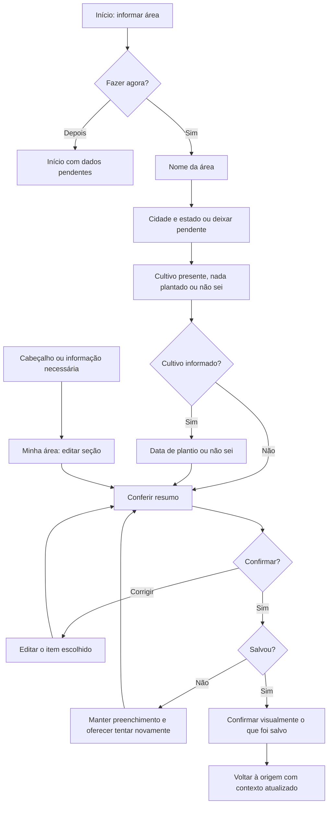

# Jornada 01 — Informar a área

Rascunho para discussão · 15/11/2026  
Destino previsto: aba **Jornadas** → sub-aba **Informar a área**.

## Objetivo e resultado

O produtor identifica o canteiro ou a área que quer acompanhar e informa o que sabe sobre o cultivo presente. Ao terminar, consegue reconhecer o contexto usado pelo aplicativo, corrigir informações e seguir para o acompanhamento ou planejamento.

**Decisão confirmada na conversa:** Minha área reúne os dados do canteiro e seu acompanhamento contínuo, incluindo a história dos cultivos e das atividades relatadas. O cadastro inicial é apenas o começo desse acompanhamento.

## Acompanhamento contínuo

- **Home:** conferir o dia e registrar rapidamente plantio, rega, colheita e aparência do canteiro.
- **Minha área:** consultar os dados e a história completa daquele canteiro, com filtro por cultivo e opções de corrigir ou excluir uma anotação.
- **Meu plano:** acompanhar as próximas intenções e etapas escolhidas.

Os três contextos usam os mesmos registros. Uma anotação feita na Home aparece em Minha área e Meu plano; sua correção ou exclusão também se reflete nos demais lugares. Não há um segundo cadastro da atividade.

No topo de Minha área, um canteiro ilustrado acompanha o cultivo informado: alface, cenoura ou tomate nesta primeira versão. O desenho identifica o cultivo; não representa quantidade, estágio de crescimento ou saúde. O histórico registra o que a pessoa contou e quando aconteceu; não presume que uma operação planejada foi executada.

Observações anteriores permanecem no histórico, mesmo quando deixam de orientar o dia atual. Não sei registra uma ausência de informação e mantém a pendência. Cultivos sucessivos da mesma espécie ainda não são separados em ciclos identificados nesta versão.

No recorte inicial, o filtro por cultivo mostra as atividades daquela cultura. Observações da aparência ficam no histórico geral do canteiro, pois não têm vínculo registrado com uma cultura. É possível excluí-las e fazer um novo relato pela Home; edição direta de observações fica posterior.

**Unidade de planejamento proposta:** um canteiro ou uma área manejada em conjunto. Uma propriedade com cultivos diferentes pode precisar de mais de uma área; essa organização ainda precisa de decisão.

## Entrada e saída

- **Primeiro uso:** convite curto no Início: “Vamos conhecer sua área?”. Pode escolher **Informar área** ou **Depois**.
- **Durante o uso:** tocar no nome da área no cabeçalho abre **Minha área** para conferir ou corrigir.
- **Aba própria:** Minha área também aparece diretamente na navegação inferior, conforme solicitado na revisão da primeira versão.
- **Quando faltar uma informação:** Planejar ou o acompanhamento leva diretamente à pergunta necessária e permite retornar ao ponto de entrada.
- **Saída:** resumo confirmado → retorno à origem. No primeiro uso, retorno ao Início com acesso a Planejar rotação.

**Proposta:** permitir conhecer o aplicativo antes de preencher tudo. Uma informação indispensável será pedida quando a ação depender dela.

## Percurso principal

Uma pergunta por bloco, com desenho, texto curto e **Ouvir**. Oferecer **Voltar**, **Corrigir** e **Depois**; usar **Não sei** onde fizer sentido. Nenhum áudio começa sozinho.

| Etapa | Pergunta e interação | Para que serve |
| --- | --- | --- |
| 1. Identificar | “Como você chama esta área?” Nome curto; sugestão editável “Meu canteiro”. | Reconhecer a área nos planos e registros. |
| 2. Localizar | “Em qual cidade fica?” Buscar município e estado; conferir o local escolhido. | Associar fontes regionais ao lugar correto. Não exigir endereço completo, GPS ou desenho no mapa. |
| 3. Cultivo presente | “O que está plantado aqui hoje?” Escolha ilustrada, Outra cultura, Nada plantado ou Não sei. | Orientar o acompanhamento e distinguir o cultivo presente da próxima escolha. |
| 4. Data, se conhecida | Para cultivo informado: “Sabe quando plantou?” Data ou Não sei. | Registrar o início relatado; data ausente permanece desconhecida. |
| 5. Conferir | Resumo visual e opção de ouvir: nome, cidade, cultivo e data conhecida. **Confirmar** ou **Corrigir** cada item. | Conferir o contexto antes de salvar. |

Nome sugerido não exige digitação. Se a cidade não for informada, permitir guardar os demais dados, com localização pendente. Previsão associada a outra cidade não pode aparecer como condição dessa área.

Se a pessoa interromper, oferecer continuar depois. **Proposta:** só incorporar mudanças aos dados compartilhados após a confirmação; ao sair com alterações, oferecer continuar preenchendo ou descartar. Cancelar preserva os dados anteriormente confirmados.

## Informações complementares

Depois do resumo, Minha área oferece blocos independentes, preenchidos quando úteis. Eles não bloqueiam a conclusão inicial.

| Bloco | Conteúdo | Momento em que ajuda |
| --- | --- | --- |
| Tamanho | Valor e unidade, com Não sei. | Comparações por área e quantidades, quando o método existir. |
| Cultivos anteriores | Cultura e período conhecido, com possibilidade de corrigir. | Avaliar sequências e retorno de famílias. |
| Água | Disponibilidade, irrigação existente e limitações relatadas. | Avaliar opções dependentes de água. |
| Solo e cuidados | Informações conhecidas, análise disponível e restrições relatadas. | Identificar condições que precisam de avaliação. |

Cada pergunta adicional precisa ter um uso explicado. Relato de solo ou aparência do canteiro não constitui diagnóstico nem autoriza calcular dose de água.

## Fluxo

## Correções e situações que precisam de cuidado

- **Cultivo desconhecido:** manter essa ausência visível e pedir a informação antes de orientações dependentes dele. Nada plantado é uma resposta diferente de Não sei.
- **Outro cultivo ou vários cultivos juntos:** preservar o relato; não encaixar à força em uma opção do catálogo. O tratamento de consórcio e subdivisão da área fica pendente de definição.
- **Cidade alterada:** retirar evidências que deixaram de se aplicar e mostrar a necessidade de atualização. Não reutilizar a previsão de Mogi para outro município.
- **Cultivo ou data corrigidos:** indicar revisão das escolhas afetadas, preservando a intenção anterior para consulta. Corrigir o cadastro não registra um novo plantio.
- **Plantio aconteceu agora:** encaminhar para o registro **Plantei**; depois, conferir o cultivo presente. O relato e a atualização do contexto têm papéis distintos.
- **Sem resultado na busca ou sem conexão:** explicar a falha, manter os campos preenchidos e permitir tentar novamente ou deixar a localização pendente.
- **Falha ao guardar:** manter o preenchimento e oferecer nova tentativa. Mostrar “Salvo” somente após sucesso.

## O que significa concluir

O cadastro inicial termina com a confirmação explícita do resumo e o salvamento dos dados conhecidos. O acompanhamento da área continua ao longo dos cultivos. Pendências podem ser completadas depois. O aplicativo mostra a origem “Informado por você” e a data da atualização.

Na implementação atual, dados e relatos persistem neste aparelho, sem conta ou sincronização de servidor. Persistência local não garante acesso offline completo nem recuperação em outro aparelho.

## Decisões para nossa conversa

1. **Entrada:** confirmar a proposta de cadastro progressivo, com opção Depois.
2. **Área:** começar com um único canteiro ou permitir cadastrar várias áreas desde o início?
3. **Cultivos misturados:** como o produtor identifica e acompanha um canteiro com mais de uma cultura?
4. **Localização:** município basta para a primeira etapa? Localização exata exige uma necessidade própria e não transforma dado regional em medição do canteiro.

## Referências e estado atual

Base: [conteúdo — Minha área e percursos](../content.md), [definição de produto congelada](../product-definition.md), [continuidade](../continuidade.md) e [design system](../design-system.md).

Primeira versão preparada no worktree `NASA-FARM-2026-minha-area`, branch `codex/minha-area`, com integração na `master` autorizada em 15/11/2026: tela `/minha-area`, dados básicos editáveis, cultivo compartilhado, histórico de atividades e observações, correção e exclusão de anotações. Armazenamento local pelo FarmProvider existente.

Recorte desta versão: uma área; nome, tamanho com unidade em texto, água e solo opcionais; cultivos Alface, Cenoura e Tomate. Cadastro de localização, data do cultivo, várias áreas, consórcios e separação formal por ciclo permanecem posteriores. A previsão continua vinculada à referência municipal de Mogi, identificada como tal. Os passos propostos acima descrevem também a evolução futura.

Revisão visual autorizada: menos ações expostas, dados do canteiro recolhidos e histórico compacto com cinco eventos e opção de expandir. Um histórico fictício de cenoura/alface pode ser carregado explicitamente em Para experimentar. Ele persiste no IndexedDB junto do estado compartilhado, mantém os registros anteriores e não duplica ao carregar novamente. Os eventos de exemplo têm identificação própria; não representam resultados agrícolas observados nem substituem a previsão real. Nenhum dado é inserido automaticamente para novos usuários.

Histórico por cultura — revisão: substituídos filtro/lista geral por cartões de Alface, Cenoura, Tomate etc., com desenho e contagem. Tocar abre Sheet com todas as atividades e observações vinculadas àquela cultura, em ordem recente, com áudio, correção e exclusão existentes. CropHistory é componente real e tem demonstração isolada no catálogo. Novas observações guardam cultivo atual informado no momento; correção posterior não reatribui histórico. Observações antigas reais sem vínculo ficam em Sem cultivo informado; fixtures conhecidas recebem vínculo explícito por ID, nunca inferido por data para relatos reais. Agrupamento por espécie, não por ciclo formal; não inferir plantio, colheita completa ou limites de ciclo.

História por cultivo e dia: cada linha reúne na mesma data as atividades, aparência relatada e conferências. Abrir revela registros originais e correção/exclusão separadas; não funde nem apaga relatos. Farm.checkHistory guarda snapshots de novas conferências por data/cultivo/observação, sem confundir conferência com rega. Não reconstrói conferências antigas inexistentes.
Contexto NASA das datas reais: série diária regional 2026 adquirida até 14/11, valores válidos até 13/11; complementa 2021–2025 via /api/nasa/history. Mesmo rótulo de data, NASA UTC versus anotação local; diferença temporal explícita nas fontes/áudio. Temperatura média e precipitação regional junto ao dia. Falta de dado não vira zero, previsão ou valor de outro ano. Fixtures locais permanecem fictícias, NASA é contexto real.
Diferenças de precipitação/relato geram apenas pergunta recolhida Vale conferir/Entender a água, sem diagnóstico, umidade medida, nutrição, perda, inadequação da cultura ou ajuste de rega. Catalogo usa CropHistory real, em estado isolado.
