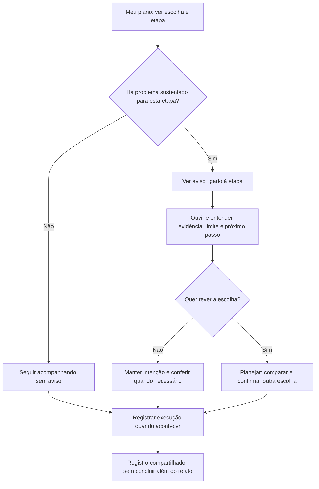

# Jornada 04 — Acompanhar o plano e revisar uma etapa

## Jornada integrada de rotação — decisão de 15/11/2026

O usuário autorizou integrar exploração, escolha e acompanhamento em Meu plano, simplificando a organização anterior que separava Planejar. Esta decisão prevalece sobre os registros históricos abaixo; a definição de produto congelada permanece intacta. `/planejar` e `/planejar/rotacao` redirecionam para `/meu-plano`. Início e Minha área levam à rotação nesse destino.

Uma única `RotationTimeline` apresenta cultivo atual, cultivos seguintes e meses, com os desenhos e a linha compartilhada de `plan-path.module.css`. `RotationPlan` lê e grava pelo FarmProvider. Editar rotação usa o mesmo NextCycles; Voltar descarta o rascunho, Guardar mantém intenção local. Cultivo atual é corrigido dentro do contexto da linha. Removidas as seções duplicadas No canteiro, Próximos cultivos, Operação com dia e Cultivo e operação da página antiga.

Preparar plantio abre o fluxo de operação e sete dias num Sheet em Meu plano, somente no primeiro próximo ciclo das três culturas já suportadas quando seu mês corresponde ao mês atual. Não supõe ano ou duração. Dias já guardados e histórico de escolhas permanecem acessíveis como apoio recolhido; nenhuma intenção ou anotação é apagada. Anotações continuam secundárias.

Ver exemplo dos próximos meses ativa um cenário identificado de novembro/2026 a agosto/2027: alface → tomate → feijão-vagem → cenoura → cebola. Sete pontos contextualizados abordam calendário, calor, laudo fictício de solo, chuva/acesso, sucessão de famílias, água e variedade. Cada ponto abre evidência fictícia, impacto condicional, ação, forma de conferir e áudio. Não há previsão de benefício, dose, perda ou duração calculada.

O cenário substitui somente a visualização da linha, com faixa Cenário de demonstração e Voltar ao meu plano. Usa o campo separado `examplePath` já existente como preferência de exibição; não altera cultivo, ciclos, meses, relatos ou revisões. Exemplos antigos já ativados passam a abrir o cenário ampliado, preservando o objeto antigo. Dados e anotações reais ficam fora da visualização demonstrativa. Não misturar predição mockada com NASA: o cenário é autoral e não é resultado das APIs; o plano real conserva os painéis NASA POWER e a previsão Open-Meteo, quando cabível.

Catálogo `/design-system#caminho` usa RotationTimeline real com o cenário completo, isolado e sem gravação. Exemplo editável demonstra a mesma linha e o editor NextCycles em memória.

Rascunho conceitual implementado em 15/11/2026. Destino previsto: aba **Jornadas** → sub-aba **Acompanhar o plano**.

## Objetivo e resultado

A pessoa consulta a intenção que guardou, entende o que vem agora e encontra, junto da etapa afetada, um aviso quando houver um ponto relevante para revisar. A tela de Meu plano é principalmente de leitura: ajuda a acompanhar a escolha e encaminha para Planejar quando a pessoa quiser revê-la.

Uma intenção (por exemplo, transplantar tomate em um dia escolhido) não é execução nem confirmação agronômica. Um aviso não muda essa intenção sozinho.

## Papel de cada tela

- **Home:** resumo do dia, sinalização da próxima etapa quando for útil e atalho para registrar o que aconteceu.
- **Meu plano:** caminho escolhido, próxima etapa e avisos associados apenas à etapa que podem afetar.
- **Planejar rotação:** explora evidências e alternativas e permite rever uma escolha.
- **Minha área:** reúne dados locais e histórico de relatos; uma correção pode pedir revisão do plano.

O mesmo registro pode ser iniciado pela Home, Meu plano ou Minha área. Os caminhos reutilizam o mesmo modal e o mesmo estado compartilhado. O registro continua sendo relato do produtor; ele só se associa a uma etapa quando o vínculo estiver explícito.

## Percurso principal

1. Abrir Meu plano e identificar o cultivo atual e a intenção seguinte.
2. Percorrer **Meu caminho**: “Agora” → próxima etapa, com operação e data quando conhecidas.
3. Se não houver problema sustentado, continuar a leitura sem um aviso preventivo genérico.
4. Se existir um problema relevante, ver uma linha curta entre as etapas; tocar expande a explicação, fonte e limite, com acesso a Planejar ou Minha área.
5. Voltar mantendo a intenção, ou revê-la e confirmar outra escolha em Planejar.
6. Quando a operação acontecer, registrar pela Home ou pelo mesmo modal em Meu plano/Minha área. O registro não muda o cultivo atual silenciosamente.

## Avisos e fontes

Avisos ficam ligados à etapa que pode ser afetada e aparecem apenas quando a análise encontra uma condição relevante. Diferenciar problema identificado de informação ausente: falta de dados deve ser apresentada como pendência, não como alerta de dano.

- **Clima/NASA POWER:** exemplo demonstrativo de uma série histórica simulada de temperatura que leva a revisar a época de uma fase do tomate. A tela real ainda não processa a amostra NASA POWER adquirida; não há janela, exposição ou dano calculado. Previsão Open-Meteo de sete dias continua sendo fonte distinta para operações próximas.
- **Solo/nutrientes:** exemplo demonstrativo de análise local simulada com baixa disponibilidade de nutrientes para o cultivo. Não é laudo da área. Sem uma análise real, método e interpretação técnica, não indicar adubo, dose ou troca de cultura.

Cada aviso resume a questão, a fonte, o limite da conclusão e um próximo passo possível. A pessoa pode ouvir, voltar, manter o plano ou abrir o contexto correspondente. Não afirmar que a NASA emitiu recomendação nem que dados regionais medem o canteiro.

## Dados demonstrativos

Meu caminho oferece **Ver exemplo de avisos**. Após carregar, o caminho e seus dois avisos aparecem diretamente no fluxo principal. Os exemplos ficam em um campo separado do estado do canteiro no IndexedDB, sem alterar cultivo atual, intenção guardada, relatos ou observações. A pessoa pode retirar o exemplo. Não carregar automaticamente para novos usuários.

Os exemplos aparecem identificados como demonstração, com limitações visíveis. Catálogo em `/design-system#caminho` apresenta o mesmo componente em estado isolado, sem gravação.

## Estados e limites desta versão

- Cultivo atual ausente: mostrar que precisa ser informado; não inventar cultura.
- Sem intenção: apontar Planejar como próximo passo; não inventar calendário.
- Com intenção: mostrar a cultura, operação e dia guardados, sem marcar como plantio realizado.
- Contexto ou previsão que mudou: preservar a escolha e indicar revisão necessária.
- Sem problema sustentado: não mostrar aviso preditivo.
- Informação insuficiente: indicar a pendência sem transformá-la em diagnóstico.
- Exemplo carregado: distinguir o caminho demonstrativo do plano real e permitir removê-lo.

Nesta entrega não há motor preditivo NASA/solo, laudo integrado, análise nutricional, associação automática entre registro e etapa, cálculo de resultado ou confirmação de execução. “Plantei”, “Reguei” e “Colhi” permanecem relatos separados da intenção.

## Referências e estado

Base: [conteúdo das telas](../content.md), [continuidade](../continuidade.md), [três perguntas preditivas](../predicao-tres-perguntas.md), [dicionário de dados](../dicionario-dados-rotacao.md) e [design system](../design-system.md).

Implementação visual: `src/frontend/plan/PlanPathDisplay.tsx`. Os dados demonstrativos versionados ficam em `src/shared/plan-path-example.ts` e são copiados para o campo `examplePath` do FarmProvider somente após ação explícita.
